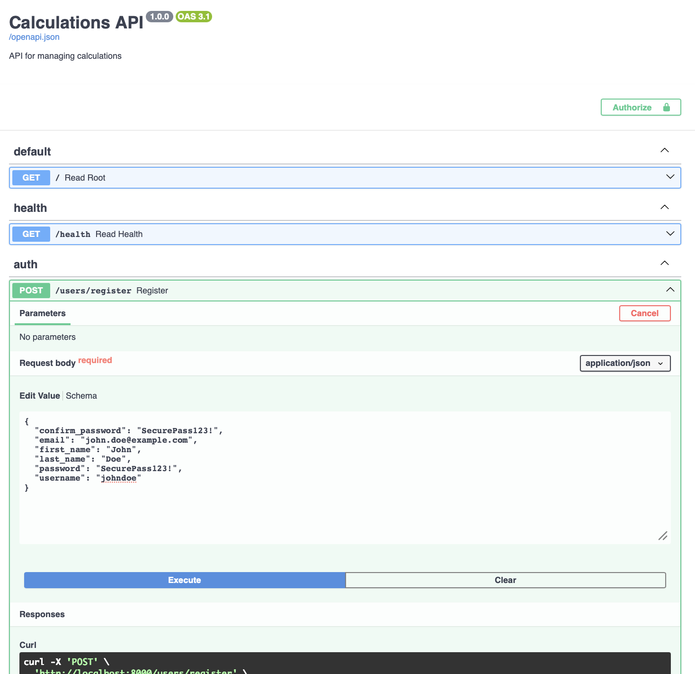

This code for the Module 12 - Assignment builds on the code used for the last module. Changes and additions have been made to meet the requirements for this current assignment.

# How to run tests locally 
Changes and additions were made to the testing suite to ensure ample amount of coverage for the added Calculation model and schema, as well as for updated packages and dependencies based on security scans in GitHub Actions. Existing test cases were also updated to account for changes made across the code for cleanup and standardization across the app.

In order to run tests, a user will need to ensure that they are running the project in a virtual environment and all requirements + dependencies have been added. 

To add a virtual environment, enter the following in the terminal: 

FOR MAC (what I used)-
```
python3 -m venv venv
```
FOR WINDOWS-
```
python -m venv venv 
```

*Interesting note: as I was running through the assignment, I generally would run into issues with getting my requirements file to install as expected. A workaround that I used was running python**3.12** instead of python3 when adding a virtual environment to start off with*

To run the virtual environment: 

FOR MAC (what I used)- 
```
source venv/bin/activate
```
FOR WINDOWS-
``` 
venv\Scripts\activate.bat 
```

To install necessary dependencies, run the following in the terminal: 
```
pip install -r requirements.txt
```
*Note: I ran into a warning that pip will need to be upgraded. This was easy to resolve by running the following in the terminal:* 
```
pip install --upgrade pip 
```

To run the unit tests, enter the following in the terminal: 
```
pytest
```
This command will run your test files, which will return a complete output with successful tests, as well as any errors/failures that come up. Traceback calls are also helpful to determine how to fix these errors and failed tests. 

A user can also check test coverage through the pytest output! A table will be displayed that shows the overall coverage and what lines do not have any tests covering them. You can better view the code by opening the **index.html** file from the htmlcov folder in the browser.

# How to do manual checks in OpenAI
Once the docker container is up and running, a user can navigate to the following URL to view their application: 
` 
http://localhost:8000
` 
8000 is the port that we are using for the application.

Update the URL to the following to view the Swagger UI and view the endpoints that live in the backend of the app: 
`
http://localhost:8000/docs
` 

A user would see a different UI with the documentation that has been set up in the main.py file. It should look something like the below screenshot: 

This can be used to: 
1. Review the available endpoints, required parameters, request headers, + authentication requirements
2. Executre API requests directly through the interface to determine that your APIs are accepting the expected information. Note: If the information/data does not meet requirements, the expected status code will get returned 
3. Validate the responses using the status codes, response payloads, and error messages - these can be compared the the expected results that are displayed and/or knowledge of the codebase

## Link to Docker Hub: 
https://hub.docker.com/repository/docker/ariellejoy/module12-assignment/general